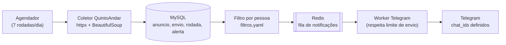

# ape-bot — Arquitetura (enxuta)

> Versão 1.1 · 27/10/2026 · Heitor Oliveiro · Apoio: Claude
> 1.1: reflete a feature `001-mvp-quintoandar-telegram` implementada (spec/plan em `specs/001-*`).
> Substitui a v0.4 (arquivada em `docs/historico/arquitetura-v0.4-completa.md`). Foco: projeto rápido.

## 1. O que é
Robô que coleta anúncios de aluguel em Belo Horizonte, guarda no MySQL e avisa no Telegram, para chats definidos, os imóveis novos que batem com o filtro de cada pessoa.

## 2. MVP

| Entra | Fica para depois |
|---|---|
| QuintoAndar (coletor próprio, superfícies públicas: `docs/spikes/001-fontes-de-dados.md`) | Configuração por botões no Telegram |
| Filtro por pessoa em `filtros.yaml` (bairros, preço máximo, quartos mínimos, tipo) | Favoritos e alerta de queda de preço |
| Aviso de imóvel novo, sem repetir | Deduplicação entre portais |
| Rodadas às 06, 09, 12, 15, 18, 21 e 23h (America/Sao_Paulo) | Regionais da PBH |
| Resumo na primeira rodada e aviso ao operador em falhas repetidas | Nuvem gerenciada (Azure) |
|  | Zap, VivaReal e OLX: feature futura (e-mail descartado pelo operador; exceção GeckoAPI na constituição 2.1.0) |

**Fora de vez:** anti-captcha e qualquer contorno de Cloudflare ou de outra proteção antirrobô feito pelo próprio robô.

**Exceção temporária (constituição 2.1.0, princípio III):** Zap, VivaReal ou OLX podem entrar pela API paga da GeckoAPI (`POST /v1/extract`, chave em `GECKO_API_KEY`), com no máximo 1 chamada de listagem por portal por rodada, busca na cidade inteira e sem chamadas de detalhe. A fonte é desligada quando a busca do familiar terminar. Orçamento: refil de 1.000 créditos por R$ 49,90, e 1 portal × 7 rodadas = 210 créditos/mês.

## 3. Fluxo



- **Telegram não envia por número de telefone.** Cada pessoa abre o bot e manda `/start` uma vez. O bot registra o `chat_id`, e o `filtros.yaml` associa filtros a esse `chat_id`. Só chats da lista recebem mensagens.
- **Redis:** fila entre "achou imóvel" e "enviou no Telegram". O worker controla o ritmo (cerca de 1 mensagem por segundo por chat) e tenta de novo em falha. Alternativa mais simples, se preferir um container a menos: fila em memória (`asyncio.Queue`).
- **Coleta:** uma requisição por combinação bairro × tipo dos filtros, na URL pública `/alugar/imovel/{bairro}-belo-horizonte-mg-brasil/{tipo}`; dados do JSON `__NEXT_DATA__`; anúncios de bairros vizinhos que o portal mistura na página são descartados.
- **Sleep:** 2 a 5 s aleatórios entre requisições ao mesmo portal, e backoff em 429/5xx. Sem seguir redirects.
- **Processo único:** bot (`/start`), agendador (`JobQueue`) e worker da fila rodam no mesmo processo; Docker Compose com `restart: unless-stopped`.

## 4. Stack
Python 3.12 · `httpx` · `beautifulsoup4` · `python-telegram-bot` (com `JobQueue`) · `redis` · `PyMySQL` + SQL puro · `pytest` · `ruff` · Docker Compose (app + MySQL + Redis). Playwright só entra se uma fonte permitida exigir JavaScript; o QuintoAndar não exige (os dados vêm no `__NEXT_DATA__`).

## 5. Dados

Tabelas `pessoa`, `anuncio`, `envio` (status pendente/entregue/falhou; PK por pessoa + anúncio impede repetição), `rodada` e `alerta`. Detalhes em `specs/001-mvp-quintoandar-telegram/data-model.md`; DDL em `migrations/001_inicial.sql`.

`resposta_fonte` (`migrations/002_resposta_fonte.sql`) guarda a resposta JSON bruta da GeckoAPI, uma linha por `requestId`, **sem dados de anunciante** (`advertiser`, `seller`, telefones e e-mail são removidos antes de gravar; princípio III). Importação manual: `docker compose run --rm -v <pasta>:/importar:ro app python -m apebot.importar_resposta /importar/*.json`.

O preço é guardado como o portal informa, em centavos.

## 6. Estrutura

```
ape-bot/
├── src/apebot/
│   ├── fontes/quintoandar.py   # URL, coleta (httpx) + parse
│   ├── fontes/geckoapi.py      # leitura da resposta GeckoAPI, sem anunciante
│   ├── importar_resposta.py    # JSON da GeckoAPI → resposta_fonte
│   ├── config.py · modelos.py  # .env, filtros.yaml, Anuncio/Filtro/Pessoa
│   ├── mensagens.py · rodada.py
│   ├── filtro.py               # regras do filtros.yaml
│   ├── banco.py                # MySQL
│   ├── fila.py                 # Redis
│   ├── telegram_bot.py         # /start, worker de envio
│   └── main.py                 # agendador e composição
├── tests/ (fixtures/ + testes de parse e filtro)
├── filtros.yaml.example
├── docker-compose.yml · Dockerfile · .env.example · pyproject.toml
└── docs/ (arquitetura.md, spikes/, historico/)
```

## 7. Testes
Só onde quebra: **parse** de cada fonte (com fixtures reais, sem internet) e **filtro**. O resto é validado rodando.

## 8. Pendências
1. Zap, VivaReal e OLX: especificar como nova feature (`/speckit-specify`) se a exceção GeckoAPI for mantida.
2. Ler os termos de uso do QuintoAndar.
3. Onde roda: máquina própria, VPS barata ou VM na nuvem. O Docker Compose funciona em qualquer uma.
4. GeckoAPI (teste no Playground em 27/10/2026, 6 créditos): VivaReal devolveu `notFound` para aluguel em BH; Zap funciona (22.060 imóveis, 30 por página), mas não ordena por data nem informa data de publicação, e traz `advertiser` com telefones; OLX ordena por data (`listedAt`), mas ignorou a localização, por campos e por URL, e devolveu 50 itens de fora de MG. Nenhum portal atende ainda ao modelo "1 chamada por rodada". As duas respostas estão em `resposta_fonte`; fixtures cortadas em `tests/fixtures/geckoapi/`. Próximo passo: chamado no suporte da GeckoAPI sobre OLX/VivaReal antes de comprar o refil.
