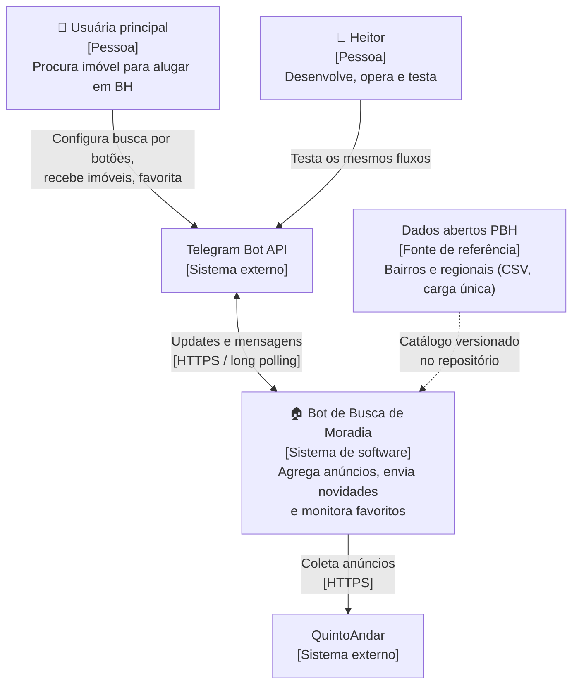
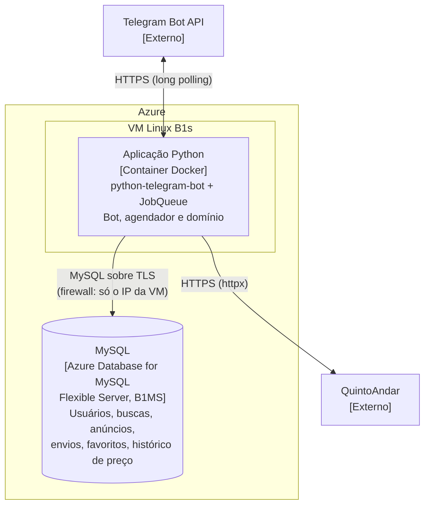
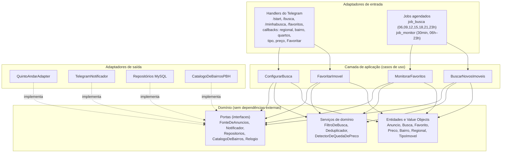
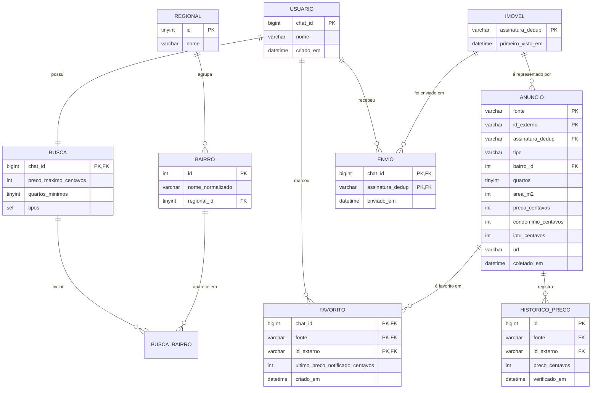

# Bot de Busca de Moradia — Documento de Arquitetura

> Versão 0.4 · 27/10/2026 · Status: rascunho para revisão
> Autor: Heitor Oliveiro · Apoio: Claude
> Versões anteriores: histórico do git

---

## Histórico de alterações

| Versão | Data | Alteração |
|---|---|---|
| 0.1 | 27/10/2026 | Versão inicial: C4, DDD, TDD, Clean Code, ADRs |
| 0.2 | 27/10/2026 | Decisões da entrevista: filtros (regional, bairro, quartos mínimos, tipo, preço do aluguel), envio de todos os imóveis, horário das 23h, usuária principal, MySQL gerenciado na Azure, robô em Docker numa VM. SQLite e Railway removidos |
| 0.3 | 27/10/2026 | Revisão para adoção do Spec Kit 1.2.4: papel do documento (seção 0), fuso horário, limite de envio do Telegram, minimização de dados, alerta operacional, `Imovel` como unidade de envio, histórico de preço por anúncio, portas assíncronas (ADR 014), roteiro de features, novas questões em aberto |
| 0.4 | 27/10/2026 | Resultado do spike 001 (`docs/spikes/001-fontes-de-dados.md`): coleta do QuintoAndar por sitemap + páginas de bairro (ADR 016), OLX fora do MVP (ADR 017), preço exibido como o portal informa (ADR 012 revisado), aviso de imóvel não encontrado, catálogo PBH + apelidos (ADR 018) |

---

## 0. Papel deste documento no Spec Kit

O projeto segue Spec-Driven Development com o **Spec Kit 1.2.4** (integração `claude`). Este documento é a **referência arquitetural de alto nível** e alimenta os artefatos oficiais, sem substituí-los:

| Artefato Spec Kit | Origem neste documento | Conteúdo |
|---|---|---|
| `.specify/memory/constitution.md` | Seções 7, 9 e 10 e RNFs | Princípios inegociáveis (o "como trabalhamos") |
| `specs/NNN-*/spec.md` | Seções 1 e 2 | O **quê** e o **porquê** de cada feature, sem tecnologia |
| `specs/NNN-*/plan.md`, `research.md`, `data-model.md` | Seções 3 a 6 e 8 | O **como**: stack, modelo de dados, decisões |
| `specs/NNN-*/tasks.md` | Seção 7.4 | Tarefas ordenadas, testes primeiro |

Quando uma feature mudar uma decisão daqui, a mudança é feita **primeiro na spec/plan da feature** e depois refletida neste documento (com nova linha no histórico).

### 0.1 Roteiro de features (fatias independentes)

| Feature | Escopo | Depende de |
|---|---|---|
| Spike de dados ✔ | Feito: `docs/spikes/001-fontes-de-dados.md`. Pendências (termos de uso, CSVs da PBH) antes da 002 | — |
| `001-configuracao-de-busca` | `/start`, whitelist, configurar busca por botões (regional → bairros, quartos, tipo, preço), `/minhabusca` | Catálogo de bairros |
| `002-envio-de-novidades` | Coleta QuintoAndar, filtro, rodadas agendadas, resumo inicial, não reenviar | 001 + spike |
| `003-favoritos-e-queda-de-preco` | Botão Favoritar, `/favoritos`, monitor de 30 min, alerta de queda | 002 |
| `004-segunda-fonte-e-deduplicacao` | Segunda fonte (OLX descartada; candidatas: Netimóveis, Zap/VivaReal) e unificação de anúncios equivalentes | 002 + novo spike |
| `005-implantacao-azure` | Infraestrutura, deploy, backup testado, alerta de orçamento | 001–003 |

---

## 1. Contexto e propósito

**Problema:** procurar imóvel para alugar em Belo Horizonte exige abrir vários portais várias vezes ao dia, refazer filtros, comparar anúncios repetidos e acompanhar manualmente se o preço de um imóvel de interesse mudou.

**Objetivo geral:** um robô em Python que agrega anúncios de aluguel de múltiplos portais, envia novidades pelo Telegram e monitora o preço dos imóveis favoritos.

**Objetivos específicos:**
- Coletar anúncios do QuintoAndar (fonte inicial). A OLX saiu do MVP (spike 001); a arquitetura comporta novas fontes.
- Filtrar por regional e bairros de BH, preço máximo do aluguel, quartos mínimos e tipo de imóvel, por usuário.
- Eliminar duplicatas entre portais.
- Enviar todos os imóveis novos às 06h, 09h, 12h, 15h, 18h, 21h e 23h.
- Permitir favoritar pelo próprio Telegram (botão inline).
- Avisar queda de preço dos favoritos (verificação a cada 30 min, janela 06h–23h).

**Objetivo de aprendizado (explícito):** praticar Python, DDD, TDD, Clean Code, arquitetura hexagonal, documentação C4 e operação em nuvem (Azure).

**Horizonte de uso:** curto (menos de 12 meses, enquanto durar a busca por imóvel). Diretriz de custo: o mais barato possível.

### 1.1 Perfis de usuário
| Perfil | Quem | O que faz |
|---|---|---|
| **Usuária principal** | A pessoa que está procurando o imóvel | Configura a busca pelo Telegram, recebe imóveis, favorita, recebe alertas de queda |
| **Desenvolvedor / testador** | Heitor | Desenvolve, opera e testa no próprio Telegram, com busca e favoritos próprios |

Cada usuário tem sua própria busca e seus próprios favoritos. A usuária principal não é técnica: **toda configuração é feita por botões**, sem comandos digitados com parâmetros.

---

## 2. Requisitos

### 2.1 Funcionais
| ID | Requisito |
|---|---|
| RF01 | Coletar anúncios de aluguel de múltiplos portais |
| RF02 | Unificar anúncios equivalentes de portais diferentes (deduplicação) |
| RF03 | Cada usuário configura: regionais e bairros de BH, preço máximo do aluguel, número mínimo de quartos e tipo (casa, apartamento ou ambos) |
| RF04 | Seleção de bairros em dois níveis: o bot lista as 9 regionais de BH; ao escolher uma, lista os bairros dela para marcar |
| RF05 | Enviar imóveis novos que atendem à busca às 06h, 09h, 12h, 15h, 18h, 21h e 23h |
| RF06 | Enviar **todos** os imóveis novos da rodada, sem limite por envio |
| RF07 | Na primeira rodada de um usuário (ou após mudança de busca), enviar um **resumo** em vez de uma mensagem por imóvel, para evitar dezenas de mensagens de uma vez |
| RF08 | Nunca reenviar ao mesmo usuário um **imóvel** já enviado, mesmo que reapareça em outro portal |
| RF09 | Mensagem com: tipo, bairro, quartos, área, aluguel, condomínio e IPTU (informativos), link e botão "Favoritar" |
| RF10 | Verificar favoritos a cada 30 min (06h–23h) e avisar queda do preço |
| RF10a | Quando um favorito não for mais encontrado no portal, avisar uma vez "imóvel não encontrado" e parar de monitorá-lo |
| RF11 | Buscas e favoritos isolados por usuário |
| RF12 | Comandos: `/start`, `/busca` (configurar), `/minhabusca` (ver), `/favoritos` (listar e remover) |
| RF13 | Avisar o desenvolvedor pelo Telegram quando uma fonte falhar em N rodadas seguidas ou quando uma rodada inteira falhar |
| RF14 | Anúncio cujo bairro não é encontrado no catálogo oficial é descartado e contabilizado no log da rodada (nunca some em silêncio) |

### 2.2 Não funcionais
| ID | Requisito |
|---|---|
| RNF01 | Segurança: o bot só responde a chat IDs autorizados (whitelist) |
| RNF02 | Segredos (token do Telegram, credenciais do banco) fora do repositório, via variáveis de ambiente |
| RNF03 | Coleta respeitosa: respeitar robots.txt, intervalo entre requisições, User-Agent identificável, baixo volume |
| RNF04 | Resiliência: falha de um portal não derruba o robô nem as outras fontes |
| RNF05 | Testabilidade: domínio testável sem internet, sem Telegram e sem banco real |
| RNF06 | Extensibilidade: nova fonte entra criando apenas um novo adaptador |
| RNF07 | Observabilidade: logs estruturados por execução (coleta, envio, erros) |
| RNF08 | Usabilidade: configuração 100% por botões, utilizável por pessoa não técnica |
| RNF09 | Custo: operar dentro da cota gratuita da Azure; alerta de orçamento obrigatório |
| RNF10 | Portabilidade: aplicação 100% em Docker, provedor substituível |
| RNF11 | Fuso horário: todos os horários (rodadas, janela 06h–23h) em `America/Sao_Paulo`, independentemente do fuso do servidor (a VM roda em UTC) |
| RNF12 | Envio respeita os limites da API do Telegram (cerca de 1 mensagem/s por chat), com fila e nova tentativa em `429 Retry-After` |
| RNF13 | Minimização de dados (LGPD): não armazenar nome, telefone ou e-mail de anunciantes; guardar só o necessário para filtrar, deduplicar e monitorar preço |

### 2.3 Fora do escopo (MVP)
- Afirmar que o imóvel "foi alugado". O sistema só sabe que o anúncio não está mais publicado e avisa "imóvel não encontrado" (RF10a).
- Busca em linguagem natural.
- Compra de imóveis.
- Recompor ou normalizar preços entre portais. O preço é usado como o portal informa (ADR 012).
- OLX como fonte (proteção antirrobô; spike 001).

### 2.4 Restrições conhecidas (robots.txt, out/2026)
- **QuintoAndar:** `/busca`, `/favoritos`, `/alertas` e URLs de aluguel com `?filters=true`, `?search_id=`, `?redirect` bloqueados. `/imovel/{id}` liberado.
- **OLX:** o próprio robots.txt responde 403 (Cloudflare) a clientes HTTP comuns. Fora do MVP.
- **Resultado completo:** `docs/spikes/001-fontes-de-dados.md`. O QuintoAndar publica sitemap de anúncios (diário) e páginas de busca por bairro (24 primeiros, com JSON embutido), ambos permitidos.
- **Consequência arquitetural:** coletar listagens amplas e permitidas e **aplicar os filtros no domínio**, localmente.
- Termos de uso dos dois portais: **pendente de leitura** (spike).
- Nenhum dos dois portais tem MCP oficial. Os MCPs encontrados são scrapers pagos de terceiros (Apify); descartados para preservar o objetivo de aprendizado.

---

## 3. Modelo C4

### 3.1 Nível 1 — Contexto do sistema



### 3.2 Nível 2 — Containers



**Ambiente de desenvolvimento:** a mesma aplicação em Docker Compose, com um container MySQL local. Testes unitários não usam banco (fakes em memória).

**Decisões deste nível (ver ADRs na seção 8):**
- Processo único: o volume (2 usuários) não justifica separar worker e bot (KISS).
- MySQL gerenciado: backup automático e sem consumir a RAM da VM.
- Long polling em vez de webhook: dispensa domínio público e certificado.

### 3.3 Nível 3 — Componentes da aplicação



**Regra de dependência:** as setas apontam sempre para dentro. O domínio não importa nada de `telegram`, `httpx` ou do driver MySQL. Adaptadores dependem do domínio, nunca o contrário (Inversão de Dependência, o "D" do SOLID).

### 3.4 Nível 4 — Código
Não será desenhado à mão. Esse nível é documentado pelo próprio código (nomes, type hints, docstrings).

---

## 4. Domain-Driven Design

### 4.1 Linguagem ubíqua
| Termo | Significado |
|---|---|
| **Anúncio** | Oferta de aluguel publicada em um portal, identificada por (portal, id_externo) |
| **Imóvel** | O bem físico. Vários anúncios podem representar o mesmo imóvel |
| **Tipo de imóvel** | Casa ou apartamento |
| **Regional** | Uma das 9 divisões administrativas de BH (Barreiro, Centro-Sul, Leste, Nordeste, Noroeste, Norte, Oeste, Pampulha, Venda Nova) |
| **Bairro** | Bairro oficial de BH, pertencente a uma regional |
| **Busca** | Critérios de um usuário: bairros, preço máximo do aluguel, quartos mínimos e tipos aceitos |
| **Preço** | Valor de aluguel **como o portal informa**, sem recomposição. É o valor usado em filtros e alertas |
| **Custo total** | Total informado pelo portal (no QuintoAndar, `totalCost`: aluguel + condomínio + IPTU + taxas). Informativo |
| **Encargos** | Condomínio e IPTU. Informativos, exibidos na mensagem |
| **Envio** | Registro de que um imóvel foi mostrado a um usuário (por meio de um de seus anúncios) |
| **Favorito** | Anúncio que o usuário escolheu acompanhar |
| **Queda de preço** | Novo valor de aluguel menor que o último registrado |
| **Fonte** | Portal de onde vêm os anúncios |
| **Rodada** | Uma execução de coleta + filtragem + envio |

### 4.2 Contextos delimitados
Um único contexto principal, com dois subdomínios:
- **Descoberta** (core): coleta, deduplicação, filtragem, envio de novidades.
- **Acompanhamento** (core): favoritos, histórico de preço, alertas.
- **Coleta de portais** fica fora do domínio, como **camada anticorrupção** (adaptadores), traduzindo o formato de cada portal para `Anuncio`.

### 4.3 Value Objects (imutáveis, comparados por valor)
- `Preco` — valor em centavos (`int`, nunca `float`), não negativo, comparável.
- `Encargos` — condomínio e IPTU opcionais (`Preco | None`).
- `Regional` — enum das 9 regionais.
- `Bairro` — nome normalizado (sem acento, minúsculo) + `Regional`; validado contra o catálogo oficial.
- `TipoImovel` — enum: `CASA`, `APARTAMENTO`.
- `IdAnuncio` — par (fonte, id_externo).
- `AssinaturaImovel` — chave de deduplicação calculada a partir das características do anúncio (seção 4.5).
- `ChatId` — identificador do usuário no Telegram.

### 4.4 Entidades e agregados
- **Usuario** (raiz de agregado): `chat_id`, `nome`, `busca: Busca`.
- **Busca** (dentro de Usuario): `bairros: frozenset[Bairro]`, `preco_maximo: Preco`, `quartos_minimos: int`, `tipos: frozenset[TipoImovel]`; método `aceita(anuncio) -> bool`.
- **Anuncio** (raiz de agregado): `id`, `tipo`, `bairro`, `quartos`, `area_m2`, `preco`, `encargos`, `url`, `coletado_em`, `historico_de_preco`. O histórico pertence ao anúncio (o preço é do anúncio, não de quem o favoritou).
- **Imovel**: agrupa anúncios equivalentes (mesma `assinatura_dedup`). É a unidade de **envio**: o usuário recebe o imóvel uma vez, com o anúncio de menor aluguel.
- **Favorito** (raiz de agregado): `chat_id`, `anuncio_id`, `ultimo_preco_notificado`; método `avaliar(preco_atual) -> PrecoCaiu | None`, que compara com o último preço avisado a esse usuário.

### 4.5 Serviços de domínio
- `FiltroDeBusca` — aplica a `Busca` a uma lista de anúncios.
- `Deduplicador` — agrupa anúncios equivalentes em um `Imovel`. MVP: assinatura por (bairro, tipo, quartos, área arredondada). O preço **fica fora** da assinatura: se entrasse, uma mudança de preço criaria um "imóvel novo" e o reenvio violaria o RF08. Evolução: similaridade de endereço.
- `DetectorDeQuedaDePreco` — compara o aluguel atual com o último preço avisado ao usuário.

### 4.6 Eventos de domínio
- `AnuncioNovoEncontrado`
- `ImovelFavoritado`
- `PrecoCaiu` (valor anterior, valor novo, percentual)

No MVP, os eventos são objetos retornados pelos casos de uso, sem barramento de eventos.

### 4.7 Portas (interfaces do domínio)
Entidades, value objects e serviços de domínio são **síncronos e puros**. As portas que fazem I/O são **assíncronas** (ADR 014), porque `python-telegram-bot` e `httpx` rodam em `asyncio`.

```python
class FonteDeAnuncios(Protocol):
    nome: str
    async def listar(self) -> list[Anuncio]: ...
    async def obter(self, id_externo: str) -> Anuncio | None: ...

class Notificador(Protocol):
    async def enviar_anuncio(self, chat_id: ChatId, anuncio: Anuncio) -> None: ...
    async def enviar_resumo(self, chat_id: ChatId, anuncios: list[Anuncio]) -> None: ...
    async def enviar_queda(self, chat_id: ChatId, evento: PrecoCaiu) -> None: ...

class CatalogoDeBairros(Protocol):
    def regionais(self) -> list[Regional]: ...
    def bairros_da(self, regional: Regional) -> list[Bairro]: ...

class RepositorioDeEnvios(Protocol):
    async def ja_enviado(self, chat_id: ChatId, assinatura: AssinaturaImovel) -> bool: ...
    async def registrar(self, chat_id: ChatId, assinatura: AssinaturaImovel) -> None: ...
```

`CatalogoDeBairros` continua síncrono: o catálogo é carregado uma vez na inicialização e fica em memória.

---

## 5. Modelagem de dados (rascunho)



Índice sugerido: `ANUNCIO(assinatura_dedup)` para a deduplicação. `HISTORICO_PRECO` só recebe linha quando o preço **muda** (não a cada verificação de 30 min), para não crescer à toa.

---

## 6. Estrutura de pastas proposta

```
ape-bot/
├── .specify/               # Spec Kit: constituição (memory/), templates, scripts
├── .claude/skills/         # skills /speckit-* instaladas pela integração claude
├── specs/                  # uma pasta por feature: spec, plan, tasks, checklists
│   └── 001-configuracao-de-busca/
├── src/moradia/
│   ├── dominio/            # entidades, value objects, serviços, portas, eventos
│   ├── aplicacao/          # casos de uso
│   ├── adaptadores/
│   │   ├── fontes/         # quintoandar.py (sitemap, página de bairro, página do imóvel)
│   │   ├── telegram/       # handlers.py, teclados.py, notificador.py
│   │   ├── catalogo/       # bairros_pbh.py
│   │   └── persistencia/   # mysql_repositorios.py, migrations/
│   ├── config.py           # leitura de variáveis de ambiente
│   └── main.py             # composição (injeção de dependências) e start
├── tests/
│   ├── unit/
│   ├── integration/        # adaptadores com fixtures; MySQL via Docker
│   └── fixtures/           # respostas reais dos portais, versionadas
├── docs/
│   ├── arquitetura.md
│   ├── adr/
│   └── CHANGELOG.md
├── docker-compose.yml      # app + MySQL para desenvolvimento
├── Dockerfile
├── .env.example
├── pyproject.toml
├── CLAUDE.md               # contexto do agente
└── README.md
```

---

## 7. Estratégia de testes (TDD)

### 7.1 Ciclo
Vermelho → Verde → Refatorar. Nenhum código de produção sem um teste falhando antes, começando pelo domínio.

### 7.2 Pirâmide
| Camada | O que testa | Como | Volume |
|---|---|---|---|
| Unitário | Value objects, `Busca.aceita`, `Deduplicador`, `DetectorDeQuedaDePreco`, casos de uso | pytest + fakes em memória das portas | Muitos, rápidos |
| Integração | Parse dos adaptadores de fonte; repositórios MySQL | Fixtures salvas dos portais; MySQL em container | Médio |
| Ponta a ponta | Rodada completa | Fonte fake + notificador fake + MySQL em container | Poucos |

### 7.3 Regras
- **Nenhum teste acessa a internet.** Respostas reais dos portais viram fixtures em `tests/fixtures/` (capturadas no spike).
- Quando um portal mudar e quebrar o parse, o primeiro passo é salvar a nova resposta como fixture e escrever o teste que falha.
- O tempo é injetado por uma porta `Relogio`, para testar horários e a janela 06h–23h sem depender da hora real.

### 7.4 Primeiros testes (ordem de implementação)
1. `Preco` rejeita valor negativo.
2. `Bairro` normaliza "Savassi" e "savassí" para o mesmo valor.
3. `Busca.aceita` aprova anúncio no bairro, do tipo aceito, com quartos ≥ mínimo e aluguel ≤ máximo.
4. `Busca.aceita` rejeita anúncio com aluguel acima do máximo.
5. `Busca.aceita` rejeita anúncio com menos quartos que o mínimo.
6. `Busca.aceita` rejeita tipo não aceito (casa quando só apartamento).
7. `Busca.aceita` ignora condomínio e IPTU na comparação de preço.
8. `Favorito.avaliar` retorna `PrecoCaiu` quando o aluguel diminui.
9. `Favorito.avaliar` retorna `None` quando o aluguel sobe ou se mantém.
10. `BuscarNovosImoveis` não reenvia ao mesmo usuário um imóvel já enviado, nem quando ele reaparece em outro portal.
11. `BuscarNovosImoveis` envia resumo na primeira rodada e mensagens individuais nas seguintes.
12. Agenda: `job_busca` dispara exatamente às 06, 09, 12, 15, 18, 21 e 23h **no horário de Brasília**, com o relógio do servidor em UTC.
13. Falha em uma fonte não impede o processamento das demais.
14. Anúncio com bairro fora do catálogo é descartado e contabilizado.

A partir da adoção do Spec Kit, esta lista serve de semente: a ordem oficial passa a ser a do `tasks.md` de cada feature.

---

## 8. Decisões arquiteturais (ADRs resumidos)

| ADR | Decisão | Motivo | Trade-off |
|---|---|---|---|
| 001 | Arquitetura hexagonal (portas e adaptadores) | Domínio testável sem portais; portais mudam com frequência | Mais arquivos que um script único |
| 002 | Processo único (bot + agendador) | Volume baixo; KISS | Se o processo cair, tudo para (mitigar com `restart: unless-stopped`) |
| 003 | **MySQL** (em vez de PostgreSQL/SQLite) | É o banco usado no trabalho com os robôs jurídicos: o aprendizado se transfere | Nenhum técnico relevante para este volume |
| 004 | `python-telegram-bot` com JobQueue | Biblioteca madura; agendamento embutido | Acoplamento ao ciclo assíncrono da lib (restrito aos adaptadores) |
| 005 | Long polling | Sem domínio público nem certificado | Latência ligeiramente maior (irrelevante aqui) |
| 006 | Preço em centavos (`int`) | Evitar erro de ponto flutuante | Conversão na borda |
| 007 | Filtros aplicados no domínio | robots.txt bloqueia filtros por URL | Coleta traz mais dados que o necessário |
| 008 | Dedup por assinatura simples no MVP | KISS; problema difícil | Falsos positivos/negativos até a evolução |
| 009 | **Azure: VM Linux B1s + MySQL Flexible Server B1MS gerenciado** | Cota gratuita de 12 meses; backup automático; banco não consome a RAM da VM (1 GB) | Banco preso à Azure; cobrança após 12 meses (aceitável: uso previsto menor que 12 meses) |
| 010 | Aplicação 100% em Docker | Portabilidade; mesmo ambiente local e em produção | Imagem a manter |
| 011 | Conta Azure criada **só no momento do deploy** | Os 12 meses gratuitos contam a partir da criação da conta | Nenhum |
| 012 | Preço usado como o portal informa, sem recomposição; filtro e alerta usam o aluguel informado | Decisão da usuária (revisada na v0.4) | Portais diferentes podem compor o valor de formas diferentes; mitigado exibindo custo total e encargos quando existirem |
| 013 | Configuração da busca por botões (inline keyboards) | Usuária principal não técnica | Mais handlers de callback |
| 014 | **Proposto:** portas de I/O assíncronas; domínio síncrono e puro | `python-telegram-bot` e `httpx` rodam em `asyncio`; evita `run_in_executor` e bloqueio do loop | Testes de casos de uso precisam de `pytest-asyncio` |
| 015 | **Proposto:** Spec Kit 1.2.4 como processo de desenvolvimento (SDD) | Especificação revisável antes do código; rastreabilidade spec → plan → tasks | Mais artefatos por feature |
| 016 | Coleta do QuintoAndar por sitemap de anúncios (diário) + páginas de bairro (a cada rodada) + página do imóvel (detalhe e favoritos). API interna **não** é usada | Únicas superfícies amplas permitidas pelo robots.txt; volume baixo | Imóvel fora das 24 primeiras do bairro chega com até 1 dia de atraso; classificados ficam de fora |
| 017 | OLX fora do MVP | Proteção antirrobô (Cloudflare) já no robots.txt; contornar fere a constituição | Uma fonte só até o spike da segunda fonte |
| 018 | **Proposto:** catálogo de bairros oficial da PBH (com regional) versionado em CSV + tabela de apelidos mantida à mão | Regionais exigem a base oficial; nomes dos portais variam | Manutenção manual dos apelidos; nomes não reconhecidos são reportados ao desenvolvedor |

Railway e VPS foram avaliados e descartados (ADR 009). Cada ADR vira arquivo próprio em `docs/adr/NNN-titulo.md` quando o repositório for criado. Decisões tomadas dentro de uma feature nascem no `research.md` dela e são promovidas a ADR quando afetam o projeto todo.

---

## 9. Clean Code — convenções do projeto

- **Nomes em português do domínio** (linguagem ubíqua): `Anuncio`, `Busca`, `registrar_preco`.
- **Funções pequenas, uma responsabilidade.** Se o nome precisa de "e", são duas funções.
- **Type hints em tudo**, verificados com `mypy --strict`.
- **Sem números mágicos:** `HORARIOS_DE_BUSCA = (6, 9, 12, 15, 18, 21, 23)`, `INTERVALO_MONITOR = timedelta(minutes=30)`.
- **Sem `print`:** `logging` com contexto (fonte, rodada, quantidade).
- **Erros explícitos:** exceções de domínio (`FonteIndisponivel`, `BairroInvalido`); nunca `except Exception: pass`.
- **Ferramentas:** `ruff` (lint + format), `mypy`, `pytest`, `pytest-cov`, `pre-commit`.
- **`dataclass(frozen=True)`** para value objects.

---

## 10. Segurança

- Whitelist de `chat_id` lida de variável de ambiente; qualquer outro chat recebe silêncio.
- `TELEGRAM_TOKEN` e credenciais do MySQL em `.env` (fora do git); `.env.example` versionado sem valores.
- **Banco:** usuário da aplicação com privilégios mínimos (só o schema do bot, sem permissões administrativas); conexão com TLS obrigatório; firewall do Flexible Server liberando apenas o IP da VM.
- **VM:** acesso SSH só por chave (senha desativada), porta 22 restrita ao seu IP, atualizações automáticas de segurança, container rodando com usuário não root.
- Validação de entrada em todo callback do Telegram (bairro existe? preço é número positivo?).
- Backup: automático do Flexible Server; testar uma restauração antes de considerar o deploy concluído.
- **Custo:** alerta de orçamento na Azure configurado **antes** de criar qualquer recurso.
- Coleta: User-Agent identificável, intervalo mínimo entre requisições, backoff exponencial em 429/5xx.

---

## 11. Questões em aberto

**Resolvidas no spike 001 / decisões da v0.4**
- ~~De onde vêm os dados~~ → JSON `__NEXT_DATA__` embutido no HTML, sitemap XML (ADR 016).
- ~~A OLX permite paginação?~~ → OLX fora do MVP (ADR 017).
- ~~Os portais informam tipo e quartos estruturados?~~ → Sim, no QuintoAndar.
- ~~Composição do preço~~ → usado como o portal informa (ADR 012).
- ~~Favorito que sai do ar~~ → aviso único "imóvel não encontrado" (RF10a).

**Em aberto**
1. Termos de uso do QuintoAndar permitem a coleta para uso pessoal? (leitura humana pendente)
2. Catálogo PBH: baixar pelo navegador os CSVs de bairro oficial e regionais (o portal bloqueia acesso automatizado) e medir quantos dos 289 bairros do QuintoAndar não casam (ADR 018).
3. Driver MySQL e ferramenta de migração: alinhar com o padrão usado nos robôs do trabalho.
4. **Conteúdo do resumo (RF07):** quantos imóveis cabem, que dados mostra e como ver os itens individualmente depois?
5. **Cota gratuita da Azure em 2026:** confirmar que B1s e MySQL Flexible B1MS seguem gratuitos por 12 meses e se o IP público estático da VM tem custo. Alternativa sem IP: acesso privado por VNet.
6. **Retenção:** por quanto tempo guardar anúncios que nunca passaram em nenhuma busca?
7. **Volume diário:** quantos imóveis novos de aluguel em BH surgem por dia no sitemap?

Item 4 entra no `/speckit-clarify` da feature 002. Item 5 entra no `research.md` da feature 005. Itens 2 e 7 fecham as pendências do spike.

---

## 12. Próximos passos

1. Revisar e aprovar este documento.
2. **Instalar o Spec Kit** e inicializar o repositório (`specify init --here --integration claude --script sh`), com as extensões `git` (branches `NNN-nome`) e `agent-context` (mantém o `CLAUDE.md`).
3. `/speckit-constitution` a partir das seções 7, 9 e 10 e dos RNFs.
4. ~~Spike de dados~~ feito (`docs/spikes/001-fontes-de-dados.md`). Fechar as pendências dele antes da feature 002.
5. Para cada feature do roteiro (seção 0.1), o caminho completo do Spec Kit: `/speckit-specify` → `/speckit-clarify` → `/speckit-plan` → `/speckit-checklist` → `/speckit-tasks` → `/speckit-analyze` → `/speckit-implement` → `/speckit-converge` (repetir implement/converge até `Converged`).
6. A fundação do repositório (`pyproject.toml`, ruff/mypy/pytest, Docker Compose com MySQL, CI no GitHub Actions, `CHANGELOG.md`) entra como fase **Setup** do `tasks.md` da feature 001.

### 12.1 DoD do spike de dados
- [ ] Termos de uso e robots.txt lidos, com decisão registrada.
- [ ] Coleta de uma listagem permitida funcionando por script.
- [ ] Consulta de um anúncio por ID funcionando.
- [ ] Campos identificados: ID, tipo, bairro, quartos, área, aluguel, condomínio, IPTU, link, status.
- [ ] Composição do preço entendida: qual campo é o aluguel puro (questão 7).
- [ ] Amostra de bairros dos anúncios cruzada com o catálogo da PBH, com o percentual que não casa (questão 8).
- [ ] Respostas salvas como fixtures.
- [ ] Nota com o resultado (viável, viável com ressalvas ou inviável) e o motivo.

## 13. Definition of Done (por funcionalidade)
- [ ] Testes escritos antes e passando
- [ ] Cobertura do domínio ≥ 90%
- [ ] ruff e mypy sem erros
- [ ] Documentação e CHANGELOG atualizados
- [ ] Revisão do próprio PR com checklist de segurança
